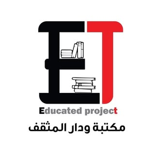
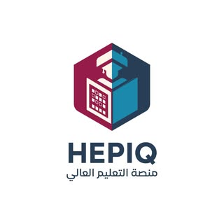
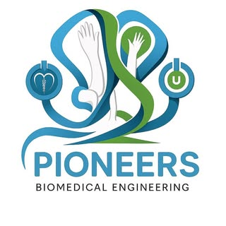
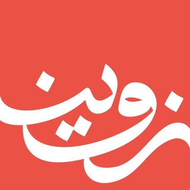
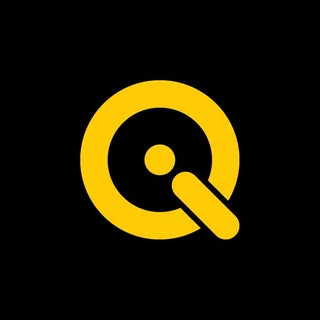

[hassan-medical-portfolio.html](https://github.com/user-attachments/files/34910511/hassan-medical-portfolio.html)
<!DOCTYPE html>
<html lang="ar" dir="rtl">
<head>
    <meta charset="UTF-8">
    <meta name="viewport" content="width=device-width, initial-scale=1.0, maximum-scale=1.0, user-scalable=no">
    <title>حسن فراس | Hassan Firas</title>
    <!-- خط Cairo من Google Fonts -->
    <link rel="preconnect" href="https://fonts.googleapis.com">
    <link rel="preconnect" href="https://fonts.gstatic.com" crossorigin>
    <link href="https://fonts.googleapis.com/css2?family=Cairo:wght@300;400;600;700;900&display=swap" rel="stylesheet">
    <!-- FontAwesome للأيقونات -->
    <link rel="stylesheet" href="https://cdnjs.cloudflare.com/ajax/libs/font-awesome/6.4.0/css/all.min.css">
    
    
</head>
<body>

    

        <!-- Language Switcher Button -->
        

            <button class="lang-btn" onclick="toggleLanguage()">
                <i class="fa-solid fa-globe"></i> English
            </button>
        

        <!-- Profile Section -->
        

            

                

                

                    
MEDCORE<i></i> LIVE

                    

ECG · LEAD II72 <small>BPM</small>
<svg class="ecg" viewBox="0 0 440 100" preserveAspectRatio="none" aria-hidden="true"><path class="ecg-grid" d="M0 20H440M0 50H440M0 80H440M55 0V100M110 0V100M165 0V100M220 0V100M275 0V100M330 0V100M385 0V100"/><path class="ecg-line" d="M0 52H75L90 49L101 52H123L136 57L149 48L163 52H178L190 52L200 17L211 87L223 36L234 52H278L291 49L302 52H324L337 58L350 47L364 52H379L391 52L401 18L412 86L424 36L435 52H450"/></svg>
SpO₂ <b>98</b><small>%</small>RESP <b>16</b><small>/min</small>TEMP <b>36.8</b><small>°C</small>

                    

                    

                

 BIOMEDICAL ENGINEERING  01 / 04

                <i class="fa-solid fa-heart-pulse"></i> Patient Monitoring<i class="fa-solid fa-wave-square"></i> Precision in every signal
            

            

                

                    
                

                

                    <i class="fa-solid fa-check"></i>
                

            

            
            <h1 class="name" id="name">حسن فراس | HaSaN FiRaS</h1>
            
            

                <i class="fa-solid fa-microscope"></i>
                مهندس أجهزة طبية | صانع محتوى تعليمي
            

            

                مرحباً بكم في صفحتي الرسمية. أشارك معكم شغفي في الأجهزة الطبية والتقنية بالإضافة إلى تغطية أحدث الشراكات والتعاونات التجارية.
            

        

        <!-- Stats Section -->
        

            

                
<i class="fa-brands fa-instagram"></i>

                
1M+

                
زيارات الإنستغرام

            

            

                
<i class="fa-brands fa-tiktok"></i>

                
9M+

                
زيارات التيك توك

            

            

                
<i class="fa-solid fa-handshake"></i>

                
6+

                
تعاونات تجارية

            

        

        <!-- Strategic Collaborations Section (Continuous Loop) -->
        

            <i class="fa-solid fa-handshake-angle"></i> التعاونات والشراكات الاستراتيجية
        

        

            

                <!-- Group 1 -->
                

                    

                        
                    

                    
Health Expo Iraq

                

                

                    

                        
                    

                    
مشروع مثقف ET

                

                

                    

                        
                    

                    
منصة التعليم العالي HEPIQ

                

                

                    

                        
                    

                    
رابطة رواد هندسة الطب الحياتي

                

                

                    

                        
                    

                    
زوين للكتب الهندسية

                

                

                    

                        
                    

                    
شركة كي كارد (QI)

                

                <!-- Group 2 Duplicate for Loop -->
                

                    

                        
                    

                    
Health Expo Iraq

                

                

                    

                        
                    

                    
مشروع مثقف ET

                

                

                    

                        
                    

                    
منصة التعليم العالي HEPIQ

                

                

                    

                        
                    

                    
رابطة رواد هندسة الطب الحياتي

                

                

                    

                        
                    

                    
زوين للكتب الهندسية

                

                

                    

                        
                    

                    
شركة كي كارد (QI)

                

            

        

        <!-- Social Links Section -->
        

            <i class="fa-solid fa-globe"></i> حساباتي الرسمية
        

        

            <!-- Instagram -->
            <a href="https://instagram.com/z29u" target="_blank" class="link-item">
                

                    

                        <i class="fa-brands fa-instagram"></i>
                    

                    

                        
حساب الإنستغرام

                        
@z29u

                    

                

                

                    <i class="fa-solid fa-chevron-left"></i>
                

            </a>

            <!-- TikTok -->
            <a href="https://www.tiktok.com/@1_6c" target="_blank" class="link-item">
                

                    

                        <i class="fa-brands fa-tiktok"></i>
                    

                    

                        
حساب التيك توك

                        
@1_6c

                    

                

                

                    <i class="fa-solid fa-chevron-left"></i>
                

            </a>
        

        <!-- Commercial / Ad Section (Moved to the bottom) -->
        

            <i class="fa-solid fa-briefcase"></i> الإعلانات والتعاون التجاري
        

        

            

                

                    

                        <i class="fa-brands fa-whatsapp"></i>
                    

                    

                        <h3 id="wa-title">مباشر واتساب للأعمال</h3>
                    

                

            

            

                <a href="https://wa.me/9647835552957" target="_blank" class="btn-whatsapp">
                    <i class="fa-solid fa-paper-plane"></i> مراسلة
                </a>
                <button class="btn-copy" onclick="copyNumber('+9647835552957')">
                    <i class="fa-regular fa-copy"></i> نسخ
                </button>
            

        

        <!-- Footer -->
        <footer id="footer">
            © HaSaN FiRaS | جميع الحقوق محفوظة
        </footer>

    

    <!-- Toast Component -->
    
تم نسخ الرقم بنجاح!

    
</body>
</html>

